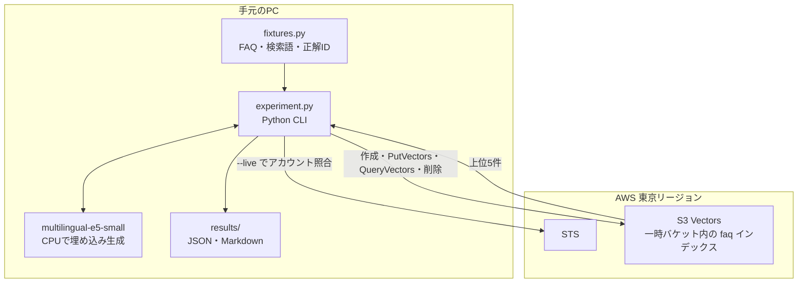

S3 Vectorsで全文検索とベクトル検索を組み合わせられるようになったと聞いて、小さく試してみた。
架空の製品FAQを100件入れて、型番や症状でどれくらい引けるかをPythonから試した。検索語は15件で、全文、ベクトル、ハイブリッドの3通り。 [AWSの発表](https://aws.amazon.com/about-aws/whats-new/2026/11/s3-vectors-hybrid-search/)

## システム構成



FAQの本文を手元でベクトルに変換して、元の本文と一緒にS3 Vectorsに登録した。検索はPythonから実行して、正解の順位と応答時間を保存した。 [全体のコード](https://github.com/hiroyannnn/learning/blob/c9af0ca85a7b238b3620b4c1884e965296e35cbc/experiments/s3-vectors/experiment.py)

## インデックスの設定

FAQは `key`、`data.float32`、`metadata` を持つ1レコードとして登録した。
`metadata` の `body` は全文検索用、`category` は絞り込み用。
本文には `passage: `、検索語には `query: ` を付けて、同じE5モデルから384次元のベクトルを作る。 [レコードの組み立て](https://github.com/hiroyannnn/learning/blob/c9af0ca85a7b238b3620b4c1884e965296e35cbc/experiments/s3-vectors/experiment.py#L72-L123) · [E5のモデルカード](https://huggingface.co/intfloat/multilingual-e5-small)

本文には `language: "ja"` で日本語用のアナライザーを指定した。

```python
def index_options(bucket_arn):
    return {
        "vectorBucketArn": bucket_arn,
        "indexName": INDEX_NAME,
        "dataType": "float32",
        "dimension": DIMENSION,
        "distanceMetric": "cosine",
        "metadataConfiguration": {
            "nonFilterableMetadataKeys": ["body"],
            "textSearchConfigurations": [{"metadataKey": "body", "language": "ja"}],
        },
    }
```

[インデックス設定のコード](https://github.com/hiroyannnn/learning/blob/c9af0ca85a7b238b3620b4c1884e965296e35cbc/experiments/s3-vectors/experiment.py#L92-L103) · [AWSの全文検索設定](https://docs.aws.amazon.com/AmazonS3/latest/userguide/s3-vectors-configuring-full-text-search.html)

## 3方式の切り替え

呼び出すAPIは3方式とも `QueryVectors`。
`queryTexts` だけを渡すとBM25による全文検索、`queryVector` だけを渡すとコサイン距離によるベクトル検索になる。
両方を渡すと、S3 Vectorsが2種類の順位をRRF（Reciprocal Rank Fusion）で統合する。 [QueryVectorsの仕様](https://docs.aws.amazon.com/AmazonS3/latest/API/API_S3VectorBuckets_QueryVectors.html)

```python
def query_options(index_arn, mode, query, vector, category=None):
    options = {"indexArn": index_arn, "topK": TOP_K}
    if mode in ("全文", "ハイブリッド"):
        options["queryTexts"] = [{"metadataKey": "body", "text": query.text}]
        options["returnScores"] = True
    if mode in ("ベクトル", "ハイブリッド"):
        options["queryVector"] = {"float32": vector}
    if mode == "ベクトル":
        options["returnDistance"] = True
    if category:
        options["filter"] = {"category": {"$eq": category}}
    return options
```

`TOP_K` は5。 `category` を渡せば同じリクエストにメタデータの絞り込みを追加できる。 [リクエストを組むコード](https://github.com/hiroyannnn/learning/blob/c9af0ca85a7b238b3620b4c1884e965296e35cbc/experiments/s3-vectors/experiment.py#L126-L137)

## AWSでの計測

`--live` を付けたときだけ、STSで照合したアカウントに実行専用のバケットとインデックスを作る。
投入と計測を `temporary_index` の中で実行し、処理から抜けるときにインデックスとバケットを削除する。 [AWS実行のコード](https://github.com/hiroyannnn/learning/blob/c9af0ca85a7b238b3620b4c1884e965296e35cbc/experiments/s3-vectors/experiment.py#L342-L439)

```python
with temporary_index(client, args.expected_account) as index_arn:
    require_success(client.put_vectors(indexArn=index_arn, vectors=batch), "PutVectors")
    rows = measure(client, index_arn, QUERIES, query_vectors, args.repeats)
```

`measure` は検索語ごとに3方式の実行順をずらし、最初に出た正解の順位とSDK呼び出しの所要時間を記録する。
型番だけの検索では同じ製品のFAQをすべて正解とし、症状を含む検索では対応する1件を正解にした。 [計測のコード](https://github.com/hiroyannnn/learning/blob/c9af0ca85a7b238b3620b4c1884e965296e35cbc/experiments/s3-vectors/experiment.py#L147-L168) · [FAQと正解ID](https://github.com/hiroyannnn/learning/blob/c9af0ca85a7b238b3620b4c1884e965296e35cbc/experiments/s3-vectors/fixtures.py)

## ローカルテスト

SDKスタブでは、3方式のパラメータと順位集計を確認する。
AWS公式EmulatorのDockerテストでは本物のSDKをループバックにつなぎ、投入、ベクトル距離順、カテゴリ絞り込み、削除まで通す。
テストデータは2件。クエリと同じ向きのベクトルを `matching`、直交するベクトルを `distractor` に割り当てる。

```python
with temporary_index(client, EMULATOR_ACCOUNT) as index_arn:
    client.put_vectors(indexArn=index_arn, vectors=batch)

    hits, _ = call_query(client, query_options(index_arn, "ベクトル", query, matching))
    self.assertEqual([hit["key"] for hit in hits], ["matching", "distractor"])
    self.assertAlmostEqual(hits[0]["distance"], 0.0)
    self.assertAlmostEqual(hits[1]["distance"], 1.0)

    filtered = query_options(index_arn, "ベクトル", query, matching, category="air")
    hits, _ = call_query(client, filtered)
    self.assertEqual([hit["key"] for hit in hits], ["distractor"])
```

通常の検索では両方が距離順に返る。 `category="air"` を付けると `distractor` の1件になる。
全文検索とハイブリッド検索の順位は、東京リージョンの実測で確認した。 [Emulatorテスト](https://github.com/hiroyannnn/learning/blob/c9af0ca85a7b238b3620b4c1884e965296e35cbc/experiments/s3-vectors/test_emulator.py#L48-L72) · [SDKテスト](https://github.com/hiroyannnn/learning/blob/c9af0ca85a7b238b3620b4c1884e965296e35cbc/experiments/s3-vectors/test_experiment.py)

## 結果メモ

東京リージョンでFAQ100件と検索語15件を使い、各方式を3周実行した。
Hit@1とHit@5は、初周で正解がそれぞれ1位以内と5位以内に入った検索語の数。応答時間は2周目以降のSDK呼び出しの中央値。

| 方式 | Hit@1 | Hit@5 | 応答時間 |
| --- | ---: | ---: | ---: |
| 全文 | 7/15 | 10/15 | 83.5 ms |
| ベクトル | 12/15 | 13/15 | 77.5 ms |
| ハイブリッド | 7/15 | 13/15 | 91.6 ms |

たとえば「BRW510 ミルがキーッと鳴る」は、全文だと正解が上位5件に入らず、ベクトルでは1位、ハイブリッドでは4位。
今回の15件ではベクトルとハイブリッドで上位5件に入った数は同じ。1位に来た数はベクトルのほうが多かった。

AWSで最初に絞り込みを試したときは、条件を付ける前から上位5件がすべて `coffee` だった。
そこで実装では、正解と別カテゴリの文書が両方含まれる検索結果を先に探し、その別カテゴリが絞り込みで落ちることを確かめるようにした。 [絞り込み検証のコード](https://github.com/hiroyannnn/learning/blob/c9af0ca85a7b238b3620b4c1884e965296e35cbc/experiments/s3-vectors/experiment.py#L171-L201)

ローカルテストとAWSでの再計測手順は、リポジトリのREADMEに置いた。 [実験README](https://github.com/hiroyannnn/learning/blob/c9af0ca85a7b238b3620b4c1884e965296e35cbc/experiments/s3-vectors/README.md)
